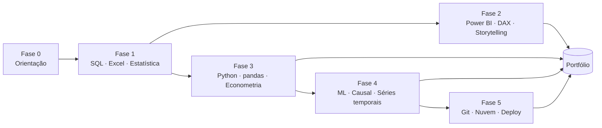

# Formação Economista de Dados 📊

Registro da minha formação em dados, organizada como um curso de especialização:
fases, módulos, exercícios, projetos e um diário de tudo o que foi estudado.

**Objetivo de carreira:** Cientista de Dados Quantitativo / Economista de Dados,
aproveitando o mestrado em Economia Aplicada, com empregabilidade no Brasil e no exterior.

**Princípio que guia tudo:** _problema antes da ferramenta_. Antes de abrir qualquer
programa, pergunto: **qual é a solução mais simples que resolve isso bem?**
Nem canhão para matar formiga, nem enxugar gelo com tarefa repetitiva.

---

## 🗺️ Mapa do curso



> O Git (Fase 5) é usado desde o primeiro dia: este repositório é o primeiro exercício.

| Fase | Módulos | Duração | Status |
|---|---|---|---|
| [Fase 0 · Orientação e diagnóstico](00-orientacao/README.md) | Carreiras em dados, Diagnóstico: problema → ferramenta | 1 a 2 semanas | ⬜ |
| [Fase 1 · Fundamentos: SQL, Excel e estatística aplicada](01-fundamentos/README.md) | SQL, Excel, Estatística aplicada a negócio | 2 a 3 meses | ⬜ |
| [Fase 2 · Power BI, DAX e storytelling](02-powerbi-storytelling/README.md) | Modelagem de dados (modelo estrela), DAX, Storytelling com dados | 1 a 2 meses | ⬜ |
| [Fase 3 · Python para análise e econometria](03-python-analise/README.md) | Python básico, pandas, Visualização (matplotlib e seaborn), Econometria com statsmodels | 2 a 3 meses | ⬜ |
| [Fase 4 · Machine Learning, inferência causal e séries temporais](04-ml-causal-series/README.md) | Machine Learning (scikit-learn), Inferência causal, Séries temporais | 3 a 4 meses | ⬜ |
| [Fase 5 · Git, nuvem básica e deploy](05-engenharia-deploy/README.md) | Git e GitHub, Nuvem básica, Streamlit e deploy | 1 a 2 meses (Git começa já na Fase 1) | ⬜ |

Legenda de status: ⬜ não iniciado · 🟨 em andamento · ✅ concluído

---

## 📁 Onde está cada coisa

```
formacao-economista-de-dados/
├── README.md              ← você está aqui: o mapa geral
├── COMO-USAR.md           ← como abrir, salvar e continuar em outro computador
├── GLOSSARIO.md           ← termos explicados em português simples
│
├── 00-orientacao/         ← carreiras e método de diagnóstico
├── 01-fundamentos/        ← SQL, Excel, estatística
├── 02-powerbi-storytelling/
├── 03-python-analise/
├── 04-ml-causal-series/
├── 05-engenharia-deploy/
│     └── (cada fase tem módulos; cada módulo tem anotacoes/ exercicios/ projeto/)
│
├── progresso/             ← diário de bordo: o "histórico escolar"
├── portfolio/             ← os melhores projetos, prontos para mostrar
├── carreira/              ← vagas, currículo, LinkedIn, inglês
├── recursos/              ← cursos, livros e bases de dados de referência
├── dados/                 ← onde ficam os arquivos de dados (ver regras dentro)
└── templates/             ← modelos prontos para novo módulo, projeto e sessão
```

### Por que está organizado assim?
- **Pastas numeradas:** a ordem do computador é a ordem de estudo.
- **Um README em cada pasta:** abrindo qualquer pasta no GitHub, a explicação aparece logo abaixo da lista de arquivos.
- **Toda pasta de módulo responde 4 perguntas:** O que é? Por que estudar? Quando usar e quando não usar? Com o que se conecta?
- **Diário separado do conteúdo:** o conteúdo diz _o que_ você aprendeu; o diário diz _quando_ e _como foi_.

---

## 🚀 Começo rápido
1. Leia [`COMO-USAR.md`](COMO-USAR.md) (10 minutos).
2. Comece pela [Fase 0](00-orientacao/README.md).
3. Ao fim de cada sessão de estudo, registre em [`progresso/`](progresso/README.md).

## 🔗 Projetos relacionados (já existentes)
- [dissertacao-pib-ntl-amazonia](https://github.com/IgorDurkheim14/dissertacao-pib-ntl-amazonia)
- [ntl-pib-municipios-brasil](https://github.com/IgorDurkheim14/ntl-pib-municipios-brasil)
- [painel-ntl-brasil-1992-2024](https://github.com/IgorDurkheim14/painel-ntl-brasil-1992-2024)
